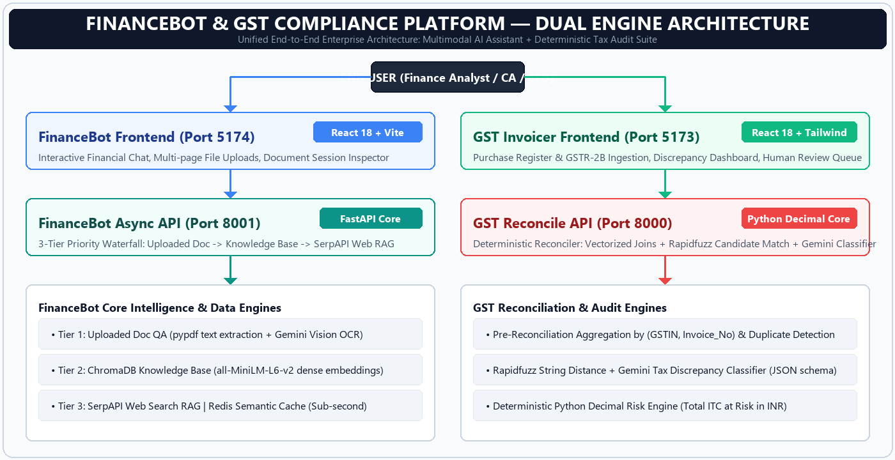
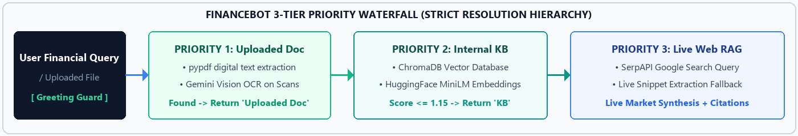
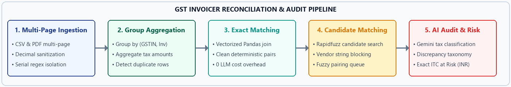

# Task A: Solution I Built — FinanceBot & GST Compliance Suite

> **Project Showcase Document**  
> **Project:** FinanceBot & GST Reconciliation Platform  
> **Architecture:** Asynchronous FastAPI, Google Gemini (Multimodal Vision & Reasoning), ChromaDB, SerpAPI Web RAG, Redis Semantic Cache, React 18, Tailwind CSS  

---

## 1. Project Overview

- **Project Name:** FinanceBot & GST Compliance Platform
- **Description:** A unified financial intelligence and compliance suite that combines an AI-powered financial document analysis and web search assistant with a deterministic tax audit reconciliation engine.
- **Purpose:** To give finance teams, accountants, and controllers a single platform to analyze complex financial documents (including scanned reports, statements, and assessment sets), retrieve verified real-time market data, and automatically reconcile vendor purchase registers against government GSTR-2B filings with mathematical precision.

---

## 2. Problem Statement

### What Problem It Solves
Finance teams and business owners face two operational bottlenecks every month:
1. **Unstructured Financial Document Analysis:** Financial filings, balance sheets, loan schedules, and assessments are shared as messy PDFs, scanned images, or multi-page reports. Traditional keyword search and standard text extraction fail completely on scanned images and tables, forcing analysts to manually read and transcribe numbers.
2. **Tax Compliance & Input Tax Credit (ITC) Risk:** Under Section 16(2)(aa) of the Indian CGST Act, a company cannot claim tax credits unless the vendor has uploaded the exact invoice to the government portal (GSTR-2B). Discrepancies lead to an 18% annual mandatory interest charge, tax penalties, and blocked working capital.
3. **Information Fragmentation:** Analysts juggle static PDF viewers, government portals, Excel spreadsheets for VLOOKUPs, and general search engines to verify market benchmarks.

### Who Experiences This Problem
- Corporate CFOs, Finance Controllers, and Tax Managers.
- Chartered Accountants (CAs) and accounting firms managing multi-client books.
- Financial analysts evaluating financial statements and corporate filings.

### Why It Matters
- **Capital Protection:** Unidentified tax discrepancies result in direct cash losses through disallowed credits and compounding interest penalties.
- **Operational Speed:** Manual cross-referencing of vendor registers and reading 50-page financial reports consumes dozens of hours every month.
- **Accuracy Guarantee:** Pure LLMs frequently hallucinate numbers and formulas. Financial software requires deterministic arithmetic combined with targeted AI reasoning.

---

## 3. Proposed Solution

I built a **dual-engine platform** accessible through an integrated web interface:

1. **FinanceBot AI Assistant (Port 8001 / 5174):**
   - An intelligent multimodal financial assistant operating on a strict **3-Tier Priority Waterfall**:
     - **Priority 1 (Uploaded Document):** Directly answers questions from uploaded financial files, balance sheets, and assessment sets. Includes automated **Gemini Vision OCR** to read scanned image PDFs that standard PDF parsers drop.
     - **Priority 2 (Internal Knowledge Base):** Searches an embedded Chroma vector store of core financial textbooks, trading rules, and accounting principles.
     - **Priority 3 (Web Search RAG):** Automatically searches Google via SerpAPI with snippet extraction to retrieve live market metrics, stock prices, and corporate news when information is absent from documents.
   - Integrated with a **Redis semantic cache** to deliver sub-second responses for repeated queries and eliminate unnecessary API costs.

2. **GST Invoicer & Reconciler (Port 8000 / 5173):**
   - An automated audit engine that ingests company purchase registers and government GSTR-2B filings (in CSV or PDF format).
   - Normalizes corporate legal names and invoice numbers to perform high-speed deterministic matching.
   - Employs rapid candidate blocking to filter edge cases, passing only ambiguous rows to Google Gemini for plain-language discrepancy categorization.
   - Calculates the exact rupee amount of **Total ITC at Risk** using strict Python `Decimal` arithmetic.
   - Provides an interactive human review queue and one-click portal navigation between the audit tool and the financial assistant.

---

## 4. System Architecture



```text
                           [ USER ]
                              │
         ┌────────────────────┴────────────────────┐
         ▼                                         ▼
[ FinanceBot UI :5174 ]                  [ GST Invoicer UI :5173 ]
  (React 18 + Vite + Tailwind)             (React 18 + Tailwind)
         │                                         │
         │ HTTP POST /chat                         │ HTTP POST /api/reconcile
         ▼                                         ▼
[ FinanceBot API :8001 ]                 [ GST Invoicer API :8000 ]
  (FastAPI Async Core)                     (FastAPI + Decimal Engine)
         │                                         │
 ┌───────┼───────────────────────┐                 ├─ PDF / CSV Ingestion
 │       ▼                       ▼                 ├─ Vectorized Exact Match
 │ [ Tier 1: Uploaded Doc ]  [ Tier 2: KB ]        ├─ Rapidfuzz Candidate Block
 │  ├─ pypdf Digital Text     ├─ ChromaDB          └─ Gemini Audit Classifier
 │  └─ Gemini Vision OCR      └─ MiniLM-L6-v2              │
 │       │                       │                         ▼
 │       └───────────┬───────────┘                [ Total ITC at Risk (INR) ]
 │                   ▼                            [ Human Review Queue ]
 │       [ Tier 3: Web Search RAG ]
 │        ├─ SerpAPI Google Search
 │        ├─ Snippet Extractor
 │        └─ Web Scraper (Trafilatura)
 │                   │
 └───────────────────┼───────────────────┐
                     ▼                   ▼
            [ Redis Cache ]     [ Gemini 3.5 Flash Lite ]
```

---

## 5. How the System Works (End-to-End Workflow)

### Workflow 1: FinanceBot Intelligence Pipeline



```text
User Question / Document Upload
      │
      ▼
[ Greeting / Identity Guard ] ──(If Greeting)──► Direct FinBot Response
      │ (If Financial Query)
      ▼
[ Tier 1: Active Uploaded Document ]
      ├─ Digital text extracted via pypdf
      ├─ If scanned PDF / images detected: Gemini Vision OCR with thumbnailing
      └─ Gemini evaluates document
            ├── Answer Found in Document ──────► Return "Uploaded Document"
            └── Absent ([NOT_IN_DOCUMENT]) ───┐
                                               ▼
[ Tier 2: Internal Knowledge Base ]
      ├─ Similarity search in ChromaDB (score <= 1.15)
      ├── Relevant Match Found in KB ──────────► Return "Internal Knowledge Base"
      └── Not in KB ───────────────────────────┐
                                               ▼
[ Tier 3: Live Web Search Fallback ]
      ├─ SerpAPI query generation
      ├─ Extract live Google snippets & trusted domain articles
      ├── Results Retrieved ───────────────────► Return "Web Search (Source URLs)"
      └── Fallback ────────────────────────────► FinBot Financial Reasoning
```

### Workflow 2: GST Invoicer Audit Pipeline



```text
Upload: Purchase Register + GSTR-2B (CSV / PDF)
      │
      ▼
[ Multi-Page Parsing & Sanitization ]
      ├─ Extracts tabular data across all pages
      ├─ Sanitizes currency strings ('18,450.00' -> Decimal(18450.00))
      └─ Normalizes invoice strings (extracts core serial, strips FY prefixes)
      │
      ▼
[ Vectorized Exact Matching (Pandas) ]
      ├─ Matches on GSTIN + Clean Invoice No + Taxable Amount
      └─ Resolves clean invoices with 0 AI overhead
      │
      ▼
[ Blocked Candidate Matching (Rapidfuzz) ]
      ├─ Partitions search space by vendor GSTIN / State code
      └─ Discovers potential candidate pairings
      │
      ▼
[ AI Discrepancy Classification (Gemini) ]
      ├─ Evaluates remaining ambiguous edge cases
      └─ Categorizes: RATE_MISMATCH, AMOUNT_DIFF, WRONG_PERIOD, MISSING_IN_2B
      │
      ▼
[ Mathematical Risk Audit & Review Queue ]
      ├─ Sums exact ITC at Risk in INR using Python Decimal
      └─ Routes low-confidence items (< 80%) to interactive review table
```

---

## 6. How It Works Under the Hood: Models, Tools, Data & Prompts

### Models Used
- **Google Gemini 3.5 Flash Lite:** Serves as the primary reasoning and synthesis engine. Selected for its rapid time-to-first-token, 1M+ token context window, native multimodal capabilities, and superior cost-to-performance ratio for financial document analysis.
- **Gemini Multimodal Vision API:** Delivers optical character recognition (OCR) and layout understanding on scanned financial PDF pages and document screenshots where traditional font extractors return zero text.
- **HuggingFace `all-MiniLM-L6-v2`:** Generates local 384-dimensional dense semantic embeddings for internal textbooks, guidelines, and scraped financial web articles. Runs entirely on CPU with zero per-embedding API costs.

### Tools & Infrastructure
- **ChromaDB:** In-process vector database persisting dense document chunk embeddings for the Tier 2 internal financial knowledge base.
- **SerpAPI & Google Search Snippets:** Real-time web search tool retrieving live market metrics, stock quotes, and corporate announcements when questions fall outside local documents.
- **Redis Semantic Cache:** Key-value store caching frequent query answers with a strict 2.0-second socket timeout and an automatic in-memory fallback.
- **Python `decimal.Decimal`:** High-precision numeric computation library enforcing banking-standard rounding (`ROUND_HALF_UP`) for statutory tax calculations.
- **Rapidfuzz & Pandas:** High-performance vectorized join and string-distance matching engine for pairing invoice records in milliseconds.
- **FastAPI & React 18:** Asynchronous Python REST backends (ports 8001 and 8000) coupled with responsive React 18 / Vite interfaces (ports 5174 and 5173).

### Data Ingested & Processed
- **Multi-Page Financial PDFs:** Ingests annual reports, earnings transcripts, loan schedules, and balance sheets.
- **Scanned Image Documents:** Handles image-only PDFs (e.g., `qualitative_LTM (1).pdf`) via automated PIL thumbnail compression and Vision OCR.
- **GST Purchase Registers (PR):** Ingests internal company ERP ledger records in CSV, Excel, or multi-page PDF format.
- **Government GSTR-2B Returns:** Ingests official monthly tax filing returns exported from the Indian Goods and Services Tax Network (GSTN).
- **Core Financial Knowledge Store:** Curated textbook chapters covering corporate finance, valuation methods, accounting standards, and Indian GST rules.

### Prompts & System Instructions
1. **Document QA Routing Prompt:**
   - *Instruction:* Enforces strict factual fidelity to the active uploaded document. If the answer cannot be verified directly from the document text, the model is strictly constrained to output the exact token `[NOT_IN_DOCUMENT]`. This enables the backend to deterministically cascade the query to Tier 2 (Knowledge Base) or Tier 3 (Web Search) without hallucination.
2. **Multimodal Vision OCR Prompt:**
   - *Instruction:* Instructs Gemini Vision to extract all dense tabular figures, balance sheet line items, footnotes, and numbered assessment questions verbatim from compressed page images, preserving column alignments without summarizing.
3. **Tax Discrepancy Classification Prompt:**
   - *Instruction:* Enforces a strict, machine-readable JSON schema for unmatched invoice rows:
     ```json
     {
       "discrepancy_category": "MISSING_IN_2B | AMOUNT_DIFF | RATE_MISMATCH | DUPLICATE_IN_BOOKS",
       "confidence_score": 0.95,
       "audit_notes": "Vendor billed 18% GST (INR 18,000) but GSTR-2B reflects 12% GST (INR 12,000)."
     }
     ```

---

## 7. Core Functionality

1. **Scanned PDF & Image Analysis:** Ingests native digital PDFs as well as scanned multi-page image documents. Automatically identifies image pages, applies thumbnail compression, and transcribes content with Gemini Vision.
2. **Deterministic 3-Tier Priority Execution:** Prioritizes user documents first, falls back to permanent vector knowledge second, and queries live web search third.
3. **Conversational Guard:** Distinguishes casual greetings from financial prompts, answering conversational inputs immediately without triggering expensive search chains.
4. **Automated Tax Reconciliation:** Automatically parses ERP exports and government tax sheets, pairing invoices and flagging duplicates.
5. **Exact Financial Risk Calculation:** Accurately sums disputed Input Tax Credit down to the rupee, avoiding probabilistic LLM arithmetic.
6. **Cross-Service Portal Navigation:** The FinanceBot navbar includes a direct link to the GST Invoicer on port 5173, allowing users to run both systems concurrently.

---

## 8. Implementation Details

- **Asynchronous File Handling:** FastAPI endpoints read uploaded file streams asynchronously into memory buffers, avoiding thread starvation and empty file stream bugs.
- **Image Optimization for OCR:** When scanned pages are detected, PIL generates optimized JPEG thumbnails (max dimension 1200px), reducing payload size by over 90% while preserving optical character clarity for Gemini Vision.
- **Snippet-First Web RAG:** Web searches extract both organic target URLs and Google search snippets. If target financial websites deploy anti-bot blocks, the system synthesizes answers directly from search snippets.
- **Connection-Resilient Caching:** Redis cache operations include a 2-second timeout and graceful degradation; if Redis is offline, the system continues running without interruption.

---

## 9. Outcome

- **Unified Workflow:** Replaced separate spreadsheet lookups, document readers, and search tabs with an integrated financial workspace.
- **Robust Multimodal Ingestion:** Handles both native digital PDFs and scanned image assessment sets without manual data entry.
- **Deterministic Tax Calculations:** Financial calculations and Input Tax Credit liabilities are strictly computed using Python `Decimal` arithmetic, avoiding generative LLM rounding and calculation errors.
- **Low Latency on Repeat Queries:** Redis semantic caching returns repeated questions in sub-second time without external API round-trips.
