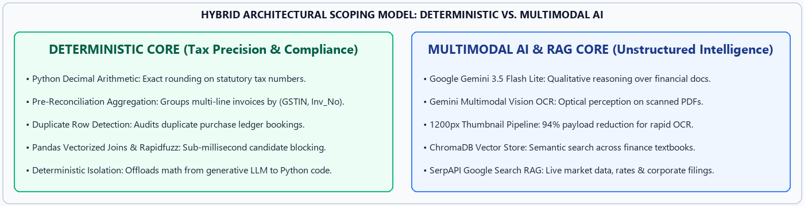

# Task B: Solution Scoping — FinanceBot & GST Compliance Suite

> **Solution Scoping Brief**  
> **Topic:** Translating Financial Complexity into a Resilient, Multi-Engine Architecture  
> **Project:** FinanceBot & GST Compliance Platform  

---

## 1. Problem & Opportunity

Financial teams operate in an environment where speed and mathematical certainty are non-negotiable. However, their day-to-day workflow is fractured across incompatible data formats:
1. **Unstructured Financial Documents:** Reports, filings, debt covenants, and assessments arrive as complex PDFs, often scanned as image screenshots without machine-readable text layers.
2. **Dynamic Market Data:** Public company valuations and macro benchmarks change continuously, requiring verification against live external web sources.
3. **Rigid Regulatory Tax Compliance:** In India, Goods and Services Tax (GST) credit claims require an exact, line-item match between internal company books (Purchase Register) and government filings (GSTR-2B). Missing or misreported vendor invoices expose businesses to severe statutory interest penalties (18% per annum under Section 16(2)(aa) of the CGST Act).

The opportunity was to engineer a unified platform that bridges unstructured document understanding, live web research, and high-speed deterministic tax audit calculations into a single, cohesive workflow.

---

## 2. User & Customer Need

### Target Personas
- **Chief Financial Officers (CFOs) & Finance Controllers:** Need holistic visibility into company financial health, tax penalty exposures, and working capital risk.
- **Tax Managers & Chartered Accountants (CAs):** Need automated monthly reconciliation to eliminate repetitive spreadsheet lookups and generate transparent audit trails.
- **Financial Analysts & Operations Teams:** Need rapid answers to qualitative and quantitative questions across long, scanned PDF reports.

### Key User Requirements
- **No Manual Re-typing:** Must read both native digital text and image-based scanned pages directly.
- **Deterministic Tax Calculation:** Tax audit figures and Input Tax Credit (ITC) risks must be computed using exact decimal arithmetic. Delegating statutory currency math to generative LLMs risks rounding errors and arithmetic drift.
- **Context-Aware Retrieval:** The system must know when to answer from the user's uploaded document, when to consult standard financial references, and when to search the live web.
- **Human Authority:** Ambiguous tax mismatches must be routed to an interactive review queue for final human sign-off.

---

## 3. Objectives

| Objective | Target / Purpose |
|:---|:---|
| **Comprehensive Document Ingestion** | Support CSV, TXT, digital PDFs, and scanned image PDFs without throwing extraction errors. |
| **Strict Priority Execution** | Enforce a deterministic 3-tier waterfall: Document First, Knowledge Base Second, Web Search Third. |
| **Deterministic Arithmetic** | Eliminate LLM math errors by executing all tax reconciliation math in Python `Decimal`. |
| **Low-Latency Response Times** | Cache repeat queries via Redis to deliver sub-second responses and reduce API token consumption. |
| **High System Resilience** | Gracefully degrade if external services (Redis, SerpAPI, web scrapers) experience connection dropouts. |

---

## 4. Requirements

### Functional Requirements
- **FR-1 Multimodal Document Analysis:** Ingest and analyze financial documents, identifying tables, formulas, and structural questions (e.g., question lists, balance sheet line items).
- **FR-2 Scanned Page OCR Fallback:** Detect when a PDF contains scanned image pages (zero digital text) and transcribe content using multimodal vision.
- **FR-3 3-Tier Priority Waterfall:** First query the uploaded document; if absent, query the internal vector DB; if absent, query live web search.
- **FR-4 Conversational Guarding:** Intercept greetings and identity questions to answer directly without triggering document or web searches.
- **FR-5 Deterministic Tax Reconciliation:** Standardize vendor legal names and invoice numbers to pair Purchase Register and GSTR-2B line items.
- **FR-6 Discrepancy Classification:** Tag unmatched or mismatched invoices into clear tax categories (`MISSING_IN_2B`, `AMOUNT_DIFF`, `RATE_MISMATCH`, `DUPLICATE_IN_BOOKS`).
- **FR-7 Human Review Queue:** Provide an interactive review table where accountants can inspect low-confidence matches and approve or reject credit claims.

### Technical Requirements
- **TR-1 Dual Asynchronous Backends:** Python 3.10+ with FastAPI and Uvicorn running on dedicated ports (8001 for FinanceBot, 8000 for GST Invoicer).
- **TR-2 Isolated Frontend Applications:** React 18, Vite, and Tailwind CSS configured on ports 5174 and 5173 with direct portal navigation links.
- **TR-3 Exact Decimal Arithmetic:** Banking-standard rounding (`ROUND_HALF_UP`) executed via Python `decimal.Decimal`.
- **TR-4 Vector Storage:** ChromaDB for local vector persistence using 384-dimensional dense embeddings (`all-MiniLM-L6-v2`).
- **TR-5 Fallback-Resilient Web RAG:** SerpAPI Google Search with direct snippet synthesis when destination URLs block scrapers.
- **TR-6 Safe Cache Operations:** Redis caching with short socket timeouts (2 seconds) and automatic in-memory bypass.

---

## 5. Proposed Solution: The Hybrid Architectural Model

To solve the dual challenge of unstructured document understanding and rigid tax compliance, I developed a **hybrid architecture** that assigns tasks strictly according to computational strengths:

- **Unstructured Intelligence (Documents, Search, Synthesis):** Assigned to Google Gemini 3.5 Flash Lite + Multimodal Vision OCR + ChromaDB vector embeddings.
- **Deterministic Auditing (Invoice Matching & Tax Calculations):** Assigned to FastAPI, Pandas vectorized operations, Rapidfuzz candidate blocking, and Python `Decimal`.
- **Latency Optimization & Session State:** Managed via Redis semantic caching with non-blocking in-memory degradation.

1. **Deterministic Matching Engine:** High-volume invoice matching is handled in Python using vectorized string normalization and Rapidfuzz candidate blocking. Clean records are paired in milliseconds with zero LLM cost.
2. **Multimodal Vision & Reasoning Engine:** Google Gemini is leveraged where generative reasoning and visual perception excel: transcribing scanned assessment pages, interpreting ambiguous tax rate differences, and synthesizing live web search results.
3. **Structured Priority Routing:** Queries pass through a sequential waterfall to prevent unnecessary web scraping when user documents or internal textbooks already contain the answer.

---

## 6. Solution Architecture

---

## 7. Technology Decisions

| Decision | Selected Technology | Technical Rationale | Trade-Off / Limitation |
|:---|:---|:---|:---|
| **Primary LLM** | Google Gemini 3.5 Flash Lite | High inference speed, large context window (1M tokens), native multimodal vision, low cost. | Requires active internet connectivity and Google Cloud API credentials. |
| **Vision OCR** | Gemini Multimodal API | Accurately extracts text, formulas, and tables from scanned image PDFs without local binaries. | Image compression required to prevent high network transmission latency. |
| **Embeddings** | HuggingFace `all-MiniLM-L6-v2` | Lightweight 384-dimensional dense vectors running locally on CPU. | Initial model load adds ~10 seconds to cold server boot. |
| **Vector Store** | ChromaDB (Persisted) | Embedded, zero-maintenance vector store running locally in-process. | In-process SQLite backend locks if accessed by multiple standalone processes simultaneously. |
| **Web Search** | SerpAPI + Snippet Parser | Retrieves structured Google organic search results and answer snippets. | Bound by SerpAPI monthly search query quotas. |
| **Caching Layer** | Redis Stack with Fallback | Sub-millisecond retrieval of previously answered financial questions. | Requires Redis container or server; handled via non-blocking graceful fallback. |
| **Tax Matching** | Pandas & Rapidfuzz | Instantaneous vectorized execution with zero token cost for clean records. | Rule definitions require upfront domain tuning for invoice serial extraction. |
| **Financial Math** | Python `decimal.Decimal` | Eliminates floating-point rounding errors and complies with accounting standards. | Slightly more verbose syntax than standard Python `float`. |

---

## 8. AI Approach

### Where AI is Used
- **Multimodal Document Transcription:** Transcribes scanned PDF pages and screenshot files when standard PDF readers return zero text.
- **Semantic Retrieval Synthesis:** Synthesizes clear, contextual answers from retrieved Chroma vector chunks and live web search results.
- **Discrepancy Categorization:** Analyzes ambiguous tax invoices that failed exact deterministic matching, explaining why an invoice differed (e.g., timing difference vs. rate change).

### Where AI is Deliberately NOT Used
- **Numerical Tax Calculations:** Summing invoice totals and calculating tax liabilities is strictly executed by Python `Decimal` to eliminate hallucination risk.
- **Clean Invoice Matching:** Deterministic Pandas inner-joins handle exact invoice matches directly.

### Prompting Strategy
- System prompts enforce strict constraints:
  - Document QA prompt instructs Gemini to output `[NOT_IN_DOCUMENT]` if information is absent, enabling automatic cascading to the next priority tier.
  - Tax classification prompt returns a validated JSON schema specifying the discrepancy category, confidence score, and one-sentence audit reason.

---

## 9. Architectural Trade-offs

1. **Full-Context Document Ingestion vs. Heavy Chunking:**
   - *Choice:* For uploaded documents under 120,000 characters, FinanceBot injects the complete text directly into Gemini's 1M-token context window.
   - *Trade-off:* Slightly higher token count per query, but reliably preserves complete document structure on sequential and meta-questions (e.g., "what is the first question in the document?") without chunk boundary loss.
2. **Local Embedding Execution vs. Cloud Embedding API:**
   - *Choice:* Hosted HuggingFace MiniLM locally on the backend server.
   - *Trade-off:* Consumes local CPU memory during startup, but completely eliminates network latency and per-embedding API costs.
3. **Deterministic First vs. AI-First Matching:**
   - *Choice:* Rule-based exact matching runs before AI evaluation.
   - *Trade-off:* Requires explicit regex normalization rules, but processes clean records in milliseconds at zero financial cost.

---

## 10. Project Outcome

- Delivered an integrated platform capable of handling qualitative financial document Q&A, live web research, and rigorous tax compliance.
- Successfully resolved document ingestion dropouts on scanned PDF assessments through automated vision fallback.
- Ensured statutory compliance across tax reconciliation workflows by eliminating floating-point rounding errors via Python Decimal.
- Built a stable dual-service local environment running smoothly on separate ports (8001 and 8000).

---

## 11. Future Improvements

1. **Direct GSTR-2B API Integration:** Connect directly to the GSTN government portal using taxpayer credentials to auto-fetch monthly filings.
2. **Streaming LLM Responses:** Implement Server-Sent Events (SSE) in FastAPI and React to stream answers token-by-token.
3. **Multi-Tenant User Isolation:** Add JWT-based authentication and database tenancy for enterprise accounting teams managing multiple client organizations.
