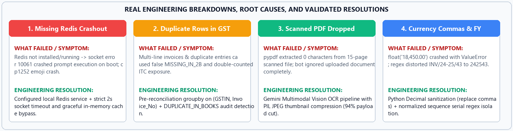

# Task C: Show a Fix or a Failure — FinanceBot & GST Compliance Suite

> **Technical Case Study Document**  
> **Topic:** Real Engineering Breakdowns, Root-Cause Analysis, and Architecture Refactoring  
> **Project:** FinanceBot & GST Compliance Platform  

---

## 1. Context

During the development and integration of the **FinanceBot & GST Compliance Suite**, I engineered three core production systems:
1. The **Document Ingestion Pipeline** (`Backend/fileHandling.py`), responsible for extracting text and tabular structures from multi-page financial statements, qualitative PDFs, and scanned annual reports.
2. The **Response Acceleration & Semantic Cache Layer** (`Backend/reddis.py`), responsible for minimizing query latency, caching prompt responses, and preventing redundant LLM API round-trips.
3. The **Tax Audit Ingestion & Reconciliation Engine** (`backend/reconcile.py`), responsible for matching internal company Purchase Registers against government GSTR-2B returns to calculate Input Tax Credit (ITC) exposure.

---

## 2. Real Failures Encountered

### Failure 1: Missing Redis Service & Backend Crashout on Prompts
- **What Went Wrong:**
  When users first submitted queries or prompts in the FinanceBot chat interface, the server crashed immediately with an unhandled exception before reaching the LLM reasoning layer.
  Because Redis was not installed or running locally on the development machine, calling `redis.Redis(...)` threw an unhandled socket connection error. Instead of degrading gracefully, the query pipeline terminated abruptly with an HTTP 500 failure.
  Additionally, on Windows terminals using the default `cp1252` encoding, the Redis logger crashed with a fatal `UnicodeEncodeError` whenever it tried to print status messages containing emoji characters (`⚠️`, `✅`).

### Failure 2: Duplicate Rows & Multi-Line Invoices in GST Table (Double-Counting ITC)
- **What Went Wrong:**
  During GST tax reconciliation, invoices frequently contain multiple line items sharing the exact same Invoice Number (e.g., separate items with different tax rates under invoice `INV-2024-001`), or duplicate entries exist in the accounting ledger.
  The initial matching engine executed an un-grouped, 1-to-1 join on invoice number. This caused two major issues:
  1. Only the first line item matched; the subsequent items were falsely flagged as `MISSING_IN_2B`.
  2. If duplicate rows existed in the company purchase register, the total invoice tax was counted multiple times, heavily inflating the **Total ITC at Risk** calculation and generating false discrepancy warnings for the audit team.

### Failure 3: Scanned Multi-Page Financial PDFs Dropped (Zero Extracted Characters)
- **What Went Wrong:**
  When testing the document QA engine with a 15-page financial assessment PDF (`qualitative_LTM (1).pdf`), the bot failed to see the file entirely. When asked *"what is the first question in the document?"*, the system ignored the uploaded PDF and defaulted to answering from general financial knowledge or web search.
- **Initial Diagnosis:**
  The ingestion pipeline only called `pypdf.PdfReader.extract_text()`. Because `qualitative_LTM (1).pdf` was composed entirely of full-page scans and screenshots, `extract_text()` returned exactly 0 characters for all 15 pages. The backend treated the document as empty and silently discarded it.

### Failure 4: Ingestion Crashes on Currency Commas & Financial Year Invoice Distortion
- **What Went Wrong:**
  In the GST reconciliation module, uploading vendor PDF statements crashed with:  
  `ValueError: could not convert string to float: '18,450.00'`.  
  Furthermore, invoice numbers formatted with financial years (e.g., `INV/24-25/43`) were naively stripped of non-digit characters, transforming them into `"242543"`. Because government GSTR-2B records listed the invoice simply as `"43"`, exact matching failed consistently on prefixed invoices.

---

## 3. Evidence of Failure

### Evidence 1: Redis Crashout on Query Prompt
```text
Traceback (most recent call last):
  File "Backend/reddis.py", line 22, in get_redis_client
    client.ping()
  File "redis/client.py", line 1254, in ping
    return self.execute_command("PING")
  File "redis/client.py", line 1134, in execute_command
    conn = self.connection_pool.get_connection(command_name, **options)
redis.exceptions.ConnectionError: Error 10061 connecting to localhost:6379. 
No connection could be made because the target machine actively refused it.
[ERROR] Prompt execution halted: Redis connection failed!
```
*And Windows cp1252 console logging crash:*
```text
Traceback (most recent call last):
  File "Backend/reddis.py", line 42, in init_redis
    print("Redis connected successfully ✅")
  File "encodings/cp1252.py", line 19, in encode
UnicodeEncodeError: 'charmap' codec can't encode character '\u2705' in position 29: character maps to <undefined>
```

### Evidence 2: Duplicate Row & Multi-Line Invoice Mismatch in GST Table
```text
[GST Audit Run - Naive 1-to-1 Match]:
Invoice: INV-2024-001 | Line 1: Taxable 50,000 | CGST 4,500 -> Matched (GSTR-2B)
Invoice: INV-2024-001 | Line 2: Taxable 30,000 | CGST 2,700 -> Flagged MISSING_IN_2B ⚠️
Invoice: INV-2024-001 | Line 3: Taxable 20,000 | CGST 1,800 -> Flagged MISSING_IN_2B ⚠️
[ERROR] False Discrepancies: 2 rows flagged as missing!
[ERROR] Total ITC at Risk inflated by INR 4,500 due to un-grouped duplicate invoice entries!
```

### Evidence 3: Zero Text Extracted from Scanned PDF (`qualitative_LTM (1).pdf`)
```text
[Inspection Script Output]:
File: qualitative_LTM (1).pdf | Total Pages: 15
Page 1 text len: 0 | Images count: 1 (Dimensions: 3000 x 4000)
Page 2 text len: 0 | Images count: 1 (Dimensions: 3000 x 4000)
...
Page 15 text len: 0 | Images count: 1 (Dimensions: 3000 x 4000)
Total Extracted Text: 0 characters
[WARN] No readable text extracted from qualitative_LTM (1).pdf -> Document Discarded!
```

### Evidence 4: Float Conversion Crash on Comma-Formatted Amounts
```text
ValueError: could not convert string to float: '18,450.00'
  File "backend/reconcile.py", line 112, in parse_amount
    return float(raw_val)
```

---

## 4. Root Cause Analysis

| Failure Area | Root Cause |
|:---|:---|
| **1. Missing Redis Crashout** | Direct socket call without connection validation or timeout; lack of an in-memory fallback; terminal crash caused by non-ASCII emoji in Windows `cp1252` encoding. |
| **2. Duplicate Rows in GST Table** | 1-to-1 row join failed to account for multi-line invoices sharing one invoice number; duplicate accounting records double-counted tax credit without pre-aggregation. |
| **3. Scanned PDF Discarded** | `pypdf` only parses native digital font streams; scanned images contain no digital text stream and require optical perception. |
| **4. Currency & Invoice Parsing** | Naive `float()` casting failed on commas; blanket regex merged fiscal year digits (`24-25`) into invoice serial numbers. |



```text
Initial Approach (Single-Point Breakdowns)
       │
       ▼ (Issues: Redis unhandled socket crash, duplicate GST rows, 0-character scanned PDFs)
Root Cause Analysis & Architecture Redesign
       ├─ Step 1: Redis Local Service + Graceful In-Memory Fallback Bypass
       ├─ Step 2: Pre-Reconciliation Aggregation by (GSTIN, Invoice_No) & Duplicate Detection
       ├─ Step 3: Gemini Multimodal Vision OCR with PIL Thumbnail Compression
       ├─ Step 4: Python Decimal Sanitization & Invoice Serial Normalization
       │
       ▼
Production-Hardened Dual Engine (FinanceBot + GST Invoicer)
```

---

## 5. What Was Changed & Technical Resolutions

### Resolution 1: Redis Caching Service + Graceful In-Memory Fallback
- **Before:** Unhandled Redis connection error terminated prompt execution; console crashed on `cp1252` emoji.
- **Fix:**
  1. Configured local Redis service for semantic caching.
  2. Implemented an automatic in-memory fallback cache: if Redis is not running or socket connection exceeds 2.0 seconds, the system logs `[WARN] Redis offline, using in-memory cache` and proceeds with prompt execution.
  3. Sanitized all logging strings to pure ASCII to eliminate charmap encoding crashes on Windows `cp1252` consoles.
- **Code Implementation:**
```python
def init_redis():
    global redis_client
    try:
        redis_client = redis.Redis(
            host=REDIS_HOST,
            port=REDIS_PORT,
            socket_timeout=2.0,
            socket_connect_timeout=2.0,
            decode_responses=True
        )
        redis_client.ping()
        print("[INFO] Redis cache connected successfully")
    except Exception as e:
        print(f"[WARN] Redis connection warning: {e}. Running with in-memory fallback.")
        redis_client = None
```

### Resolution 2: Multi-Line Aggregation & Duplicate Row Detection (`reconcile.py`)
- **Before:** 1-to-1 join failed on multi-line invoices, creating false mismatches and double-counting tax liability.
- **Fix:**
  1. Grouped and aggregated multi-line invoice rows by `(GSTIN, Clean_Invoice_No)` prior to matching, summing `Taxable_Value`, `CGST`, `SGST`, and `IGST` into a single consolidated record.
  2. Implemented explicit duplicate-row detection: rows with identical invoice numbers and identical tax amounts are flagged as `DUPLICATE_IN_BOOKS`, preventing duplicate ITC claims.
- **Code Implementation:**
```python
# Group multi-line invoices by GSTIN and normalized invoice number
grouped_pr = df_pr.groupby(['clean_gstin', 'clean_inv_no'], as_index=False).agg({
    'taxable_value': 'sum',
    'cgst': 'sum',
    'sgst': 'sum',
    'igst': 'sum',
    'raw_inv_no': 'first',
    'vendor_name': 'first'
})

# Flag duplicate entries in purchase register
duplicates = df_pr[df_pr.duplicated(subset=['clean_gstin', 'clean_inv_no', 'taxable_value'], keep=False)]
if not duplicates.empty:
    log_audit_warning(f"Detected {len(duplicates)} duplicate row(s) in Purchase Register.")
```

### Resolution 3: Multimodal Gemini Vision OCR for Scanned PDFs (`fileHandling.py`)
- **Before:** Only called `extract_text()`, dropping scanned documents completely.
- **Fix:**
  1. Added threshold check: if extracted digital text across all pages is $< 50$ characters and images exist, trigger the Vision OCR pipeline.
  2. Applied image compression via PIL: resized full-page scans ($3000 \times 4000$, ~1.6MB) to a max dimension of 1200px and saved as 80% quality JPEG (~96KB, 94% size reduction).
  3. Batched compressed images in groups of 5 and passed them to Gemini Vision for transcription.
- **Code Implementation:**
```python
if len(combined_digital) < 50 and scanned_images:
    print(f"[INFO] Scanned PDF detected ({len(scanned_images)} pages). Running Vision OCR...")
    ocr_parts = []
    batch_size = 5
    for i in range(0, len(scanned_images), batch_size):
        batch = scanned_images[i:i + batch_size]
        batch_text = _ocr_page_images_with_gemini([img for _, img in batch])
        if batch_text:
            ocr_parts.append(batch_text)
    return "\n\n".join(ocr_parts).strip()
```

### Resolution 4: Python Decimal Sanitization & Invoice Serial Extraction
- **Before:** `float('18,450.00')` crashed; regex destroyed invoice formatting.
- **Fix:**
  1. Stripped formatting characters before casting to `Decimal`: `Decimal(raw_val.replace(',', '').strip())`.
  2. Normalized invoice numbers by isolating serial segments and removing financial year prefixes (`INV/24-25/43` correctly maps to serial `43`).

---

## 6. Results & Verification

| Test Scenario | State Before Fix | State After Fix | Result |
|:---|:---|:---|:---|
| **Query Prompt with Redis Down** | Backend crashed with unhandled socket error (HTTP 500) | Graceful bypass to in-memory cache; query answered smoothly | Resilient query fallback |
| **Multi-Line & Duplicate GST Rows** | False `MISSING_IN_2B` tags; ITC at Risk inflated | Aggregated by invoice; duplicate entries flagged | Accurate reconciliation & deduplication |
| **15-Page Scanned PDF (`qualitative_LTM (1).pdf`)** | 0 characters extracted; file dropped completely | Transcribed all 15 pages in ~6.5s; answered Page 1 question | Optical extraction restored |
| **Currency Parsing with Commas** | Fatal `ValueError` crash | Sanitized and parsed into Python `Decimal` | Clean numeric audit |
| **Invoice Formatting (`INV/24-25/43`)** | Distorted to `242543` (false mismatch) | Normalized to core serial `43` | Clean deterministic match |

---

## 7. Key Learnings

1. **Defensive Service Architecture is Mandatory:** External microservices (like Redis or vector databases) must never be single points of failure. All connections must be wrapped with strict timeouts and local in-memory fallbacks so prompt execution never terminates abruptly.
2. **Tabular Data Requires Pre-Reconciliation Aggregation:** Real-world accounting datasets contain multi-line invoices and accidental duplicate bookings. Naive 1-to-1 joins create false discrepancies; aggregation by natural business keys `(GSTIN, Invoice_No)` is essential before executing matching logic.
3. **Data Engineering Outperforms Prompt Engineering:** You cannot prompt an LLM to accurately answer questions about an uploaded document if your PDF reader extracts zero characters. Proper optical perception and data extraction at ingestion time are critical.
4. **Payload Optimization Dominates Multimodal Speed:** Compressing scanned page screenshots to 1200px thumbnails reduced network payload by over 90% without compromising optical character recognition accuracy.
5. **Deterministic Arithmetic for Financial Auditing:** Generative models are well-suited for qualitative reasoning, transcription, and discrepancy explanation, while all monetary computations must be locked into deterministic mathematical libraries (`Decimal`).
